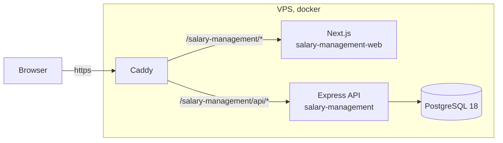
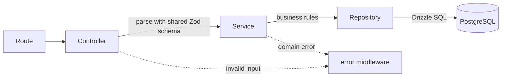

# Salary Management

A web app for ACME's HR manager to manage salary data for 10,000 employees across 8 countries, and to answer questions about how the company pays people. It replaces a set of Excel sheets.

- Live: https://dharmjeet.com/salary-management
- API: https://dharmjeet.com/salary-management/api/meta

## What the HR manager can do

- Find anyone among 10,000 employees: search by name or email, filter by country, department and job title, sort by name, hire date, or salary inside one country
- Add, edit and delete an employee, with a clear message on every field
- See pay per country, then per department and job title inside a country, always in that country's currency
- See who is paid well below the median for their job title in their country (under 70, 80 or 90%), and open their record to fix it

Every list and filter lives in the URL, so a view can be bookmarked or shared, and saving an edit returns to the same view.

## For reviewers

| What                       | Where                                                                                                                                                                                                                    |
| -------------------------- | ------------------------------------------------------------------------------------------------------------------------------------------------------------------------------------------------------------------------ |
| Requirements, one page     | [SPEC.md, Part 1](docs/SPEC.md#part-1-requirements-one-page), written before any code (first commit)                                                                                                                     |
| Spec, single source        | [docs/SPEC.md](docs/SPEC.md): domain, architecture, data model, API, pages, seed, tests, deploy                                                                                                                          |
| How AI was used            | [docs/ai-usage.md](docs/ai-usage.md): setup, prompts, and where the AI was wrong                                                                                                                                         |
| Trade-offs and performance | [docs/tradeoffs.md](docs/tradeoffs.md)                                                                                                                                                                                   |
| Rules for the AI agent     | [CLAUDE.md](CLAUDE.md)                                                                                                                                                                                                   |
| Deploy                     | [docs/deploy.md](docs/deploy.md)                                                                                                                                                                                         |
| How it evolved             | [issues](https://github.com/dharmjeet05/salary-management/issues?q=is%3Aissue), [pull requests](https://github.com/dharmjeet05/salary-management/pulls?q=is%3Apr+is%3Amerged) with their reviews, and the commit history |

Each task was a GitHub issue, built on its own branch, test first, reviewed on its PR and merged with a merge commit, so the history shows every step.

## Architecture



Inside the API every request takes the same path, and each layer has one job:



- `apps/api`: Express. Routes, controllers, services, repositories, one error middleware
- `apps/web`: Next.js with shadcn/ui and TanStack Query. Pages only compose feature components. Data logic sits in hooks
- `packages/shared`: the domain (countries, currencies, departments, job titles) and the Zod schemas, used by both the API and the form
- `packages/db`: Drizzle schema, migrations and the seed

More in [SPEC.md, Part 3](docs/SPEC.md#part-3-architecture).

## Numbers

| What                    | Measured                                                         |
| ----------------------- | ---------------------------------------------------------------- |
| Tests                   | 339 (shared 65, db 25, api 124, web 125), all in about 9 seconds |
| Database in tests       | real Postgres in process (PGlite), no mocks                      |
| Seed                    | 10,000 employees, every name different, in about a second        |
| API on the live site    | 110 to 210 ms per call from a laptop, network included           |
| Requests for one search | 1 API call and 1 page request                                    |
| Docker image            | 397 MB, the API and the web app together                         |

How they were measured, and what changes at a bigger scale: [docs/tradeoffs.md](docs/tradeoffs.md#performance).

## Run locally

Needs Node 24 (`nvm use`), pnpm and a PostgreSQL database.

```bash
pnpm install
cp apps/api/.env.example apps/api/.env
cp apps/web/.env.example apps/web/.env.local
cp packages/db/.env.example packages/db/.env
pnpm db:migrate
pnpm db:seed
pnpm dev
```

Set `DATABASE_URL` in `apps/api/.env` and `packages/db/.env` to your database.

API on http://localhost:4000, web app on http://localhost:3000/salary-management.

## Checks

The tests need no database. They run against PGlite.

```bash
pnpm lint
pnpm typecheck
pnpm test
pnpm build
```

CI runs the same on every pull request.

## Deploy

The web app, the API and PostgreSQL run on a VPS behind Caddy, from one Docker image. Steps: [docs/deploy.md](docs/deploy.md).
