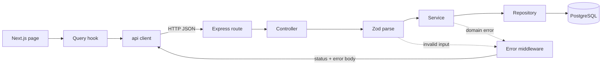

# Salary Management: Spec

This file is the single source of truth for the project.
Every task (GitHub issue) points to a section here.
If the plan changes, this file changes first, in its own PR.

Part 1 is the one page requirements doc.
Parts 2 to 11 are the build spec.

---

## Part 1. Requirements (one page)

### Goal

Give ACME's HR manager one web app to manage salary data for 10,000 employees across several countries, and to answer questions about how the company pays people.
Today this lives in Excel sheets, which is slow to search, easy to break and hard to analyse.

### User

One persona: the HR manager. They are not technical. They want to find a person fast, fix a salary, and see how pay compares across countries, departments and job titles.

### In scope

1. Employee directory
   - List all employees with server side pagination
   - Search by name or email
   - Filter by country, department and job title
   - Sort by name, salary or hire date
2. Manage employees
   - Add, edit and delete an employee
   - Clear validation messages on every field
3. Salary insights
   - Per country: headcount, min, max, average and median salary
   - Per job title inside a country: headcount, min, max, average, median
   - Per department inside a country: headcount and total salary cost
   - Underpaid check: people paid well below the median for their job title in their country
4. Seed data
   - One command creates 10,000 realistic employees
   - Same input gives the same data every time
5. Deployed
   - Web app, API and database on a VPS under `https://dharmjeet.com/salary-management`, plus a short video demo

### Deliberately left out

| Left out                                                | Why                                                                                                                          |
| ------------------------------------------------------- | ---------------------------------------------------------------------------------------------------------------------------- |
| Login and roles                                         | One persona and demo data only. First thing to add before real use.                                                          |
| Excel / CSV import and export                           | The most useful next feature, since HR lives in Excel today. Left out to keep the core solid first.                          |
| Payroll, tax, payslips                                  | A different product. This app manages salary data, it does not pay people.                                                   |
| Currency conversion and org wide totals in one currency | Rates change every day, so a single total would be wrong or misleading. Every number stays in the employee's local currency. |
| Salary history and audit log                            | Useful, but not needed to answer the core pay questions. Edits overwrite the current value.                                  |
| Bonuses, equity, allowances                             | Only base annual salary is modelled.                                                                                         |

### Success means

- The HR manager can find any of the 10,000 employees in a few seconds
- They can answer "what do we pay a Senior Software Engineer in India" without a spreadsheet
- Every list and insight responds in well under a second on the seeded data

---

## Part 2. Domain

### Employee

| Field                | Type      | Rules                                                           |
| -------------------- | --------- | --------------------------------------------------------------- |
| id                   | integer   | generated                                                       |
| fullName             | string    | required, 2 to 100 chars, trimmed                               |
| email                | string    | required, valid email, unique, stored lower case                |
| country              | enum      | one of the supported countries                                  |
| currency             | enum      | derived from country on the server, never sent by the client    |
| department           | enum      | one of the departments                                          |
| jobTitle             | enum      | one of the job titles, and must belong to the chosen department |
| annualSalary         | integer   | whole units of the local currency, 1 to 100,000,000             |
| hireDate             | date      | required, from 1950-01-01 up to today in any time zone          |
| createdAt, updatedAt | timestamp | set by the server                                               |

### Countries and currencies

| Country        | Code | Currency |
| -------------- | ---- | -------- |
| India          | IN   | INR      |
| United States  | US   | USD      |
| United Kingdom | GB   | GBP      |
| Germany        | DE   | EUR      |
| Canada         | CA   | CAD      |
| Australia      | AU   | AUD      |
| Singapore      | SG   | SGD      |
| Brazil         | BR   | BRL      |

### Departments and job titles

| Department       | Job titles                                                                                    |
| ---------------- | --------------------------------------------------------------------------------------------- |
| Engineering      | Software Engineer, Senior Software Engineer, Staff Engineer, Engineering Manager, QA Engineer |
| Product          | Product Manager, Senior Product Manager                                                       |
| Design           | Product Designer, Senior Product Designer                                                     |
| Data             | Data Analyst, Data Scientist                                                                  |
| Sales            | Sales Representative, Account Executive, Sales Manager                                        |
| Marketing        | Marketing Specialist, Marketing Manager                                                       |
| Customer Support | Support Specialist, Support Team Lead                                                         |
| Finance          | Accountant, Finance Manager                                                                   |
| People           | HR Generalist, HR Manager                                                                     |
| Operations       | Operations Specialist, Operations Manager                                                     |

These lists live in `packages/shared` as constants. The API, the seed and the web app all read from there.

### Insight definitions

- Average: arithmetic mean, rounded to the nearest whole unit
- Median: `percentile_cont(0.5)` over the group, rounded to the nearest whole unit
- A group with no employees is not returned
- Underpaid: salary below 80% of the median for the same job title in the same country. The threshold is a query param with default 0.8
- Every money value is returned with its currency. Values in different currencies are never added together

### Insight responses

Every response names the currency once, next to the numbers it applies to.

- `GET /api/insights/countries`: `{ countries: [{ country, currency, headcount, minSalary, maxSalary, averageSalary, medianSalary }] }`, biggest headcount first
- `GET /api/insights/countries/:country/job-titles`: `{ country, currency, jobTitles: [{ department, jobTitle, headcount, minSalary, maxSalary, averageSalary, medianSalary }] }`, by department, then job title
- `GET /api/insights/countries/:country/departments`: `{ country, currency, departments: [{ department, headcount, totalSalary }] }`, biggest total first
- `GET /api/insights/countries/:country/underpaid`: `{ country, currency, threshold, employees: [{ id, fullName, department, jobTitle, annualSalary, medianSalary, percentOfMedian }] }`, lowest `percentOfMedian` first, then id. `percentOfMedian` is a whole number, 64 means 64% of the median
- A country with nobody in it gives empty lists, not a 404, since the country itself is valid

---

## Part 3. Architecture

### Stack

All TypeScript.

| Part       | Choice                                                        |
| ---------- | ------------------------------------------------------------- |
| Monorepo   | pnpm workspaces + Turborepo                                   |
| Web        | Next.js (App Router), Tailwind CSS, shadcn/ui, TanStack Query |
| API        | Express                                                       |
| Database   | PostgreSQL + Drizzle ORM                                      |
| Validation | Zod, shared by API and web                                    |
| Tests      | Vitest, Supertest, PGlite (Postgres in process)               |
| CI         | GitHub Actions                                                |
| Hosting    | own VPS (web, API, PostgreSQL) behind Caddy                   |

### Repo layout

```
apps/
  api/                 Express API
    src/
      routes/          URL to controller wiring only
      controllers/     parse request with shared Zod schemas, call service, send response
      services/        business rules, no Express, no SQL
      repositories/    all database access, Drizzle queries
      middleware/      error handler, not found handler
      errors/          domain errors (NotFound, EmailTaken)
      config/          environment variables, checked on start
      app.ts           builds the Express app (used by tests)
      server.ts        starts the server
  web/                 Next.js app
    src/
      app/             routes and layouts, thin pages only
      features/
        employees/
          api/         fetch functions for this feature
          hooks/       TanStack Query hooks, all data logic
          components/  UI only, props in, events out
        insights/
          api/ hooks/ components/
      components/ui/   shadcn components
      lib/             api client, query client, formatters
packages/
  shared/              constants, Zod schemas, shared types
  db/                  Drizzle schema, migrations, client, seed
  config/              shared tsconfig and eslint config
docs/
  SPEC.md              this file
  ai-usage.md          how AI tools were used, prompts, what was fixed by hand
  tradeoffs.md         decisions and what was given up, performance
  deploy.md            steps for the VPS
  demo-script.md       the walkthrough for the demo video
```

### Request flow



### Layer rules

- Routes only map URLs to controllers
- Controllers never contain business rules or SQL
- Controllers parse params, query and body with the shared Zod schemas. A parse error goes to the error middleware and becomes a 400. There is no separate validation middleware, because Express 5 makes `req.query` read only and a middleware would lose the parsed type
- Services never import Express or Drizzle query builders directly, they call repositories
- Repositories never throw HTTP errors, they return data or null. The one exception is a database error they understand: a unique email violation becomes `EmailTakenError`. No SELECT before an insert to check, the constraint decides
- Services throw domain errors. One error middleware maps them to HTTP status codes
- Pages in `app/` only compose feature components. Data fetching and state live in hooks
- No extra abstractions without a real need: no DI container, no generic base repository

---

## Part 4. Data model

### Table `employees`

| Column        | Type                                             | Notes                |
| ------------- | ------------------------------------------------ | -------------------- |
| id            | integer generated always as identity primary key |                      |
| full_name     | varchar(100) not null                            |                      |
| email         | varchar(255) not null unique                     | lower case           |
| country       | char(2) not null                                 | ISO code             |
| currency      | char(3) not null                                 | derived from country |
| department    | varchar(50) not null                             |                      |
| job_title     | varchar(80) not null                             |                      |
| annual_salary | integer not null                                 | check > 0            |
| hire_date     | date not null                                    |                      |
| created_at    | timestamptz not null default now()               |                      |
| updated_at    | timestamptz not null default now()               |                      |

### Indexes

- `(country, job_title)` for insights and filters
- `(country, department)` for insights and filters
- `(department)`, `(job_title)` for filters without a country
- No index for search. Search is a case insensitive "contains" match on name or email, which a btree index can't serve. A scan of 10,000 rows takes a few milliseconds. At a million rows, add a `pg_trgm` GIN index
- Email is already indexed by the unique constraint

Migrations are generated with drizzle-kit and committed.

---

## Part 5. API

Base path `/api`. JSON in and out.

### Endpoints

| Method | Path                                         | Purpose                                              |
| ------ | -------------------------------------------- | ---------------------------------------------------- |
| GET    | /health                                      | liveness check                                       |
| GET    | /api/meta                                    | countries with currency, departments with job titles |
| GET    | /api/employees                               | list with pagination, search, filters, sort          |
| GET    | /api/employees/:id                           | one employee                                         |
| POST   | /api/employees                               | create                                               |
| PATCH  | /api/employees/:id                           | partial update                                       |
| DELETE | /api/employees/:id                           | delete                                               |
| GET    | /api/insights/countries                      | stats per country                                    |
| GET    | /api/insights/countries/:country/job-titles  | stats per job title in a country                     |
| GET    | /api/insights/countries/:country/departments | headcount and cost per department in a country       |
| GET    | /api/insights/countries/:country/underpaid   | underpaid employees in a country, `?threshold=0.8`   |

### List query params

| Param                         | Default  | Rules                                                |
| ----------------------------- | -------- | ---------------------------------------------------- |
| page                          | 1        | integer >= 1                                         |
| pageSize                      | 25       | one of 10, 25, 50, 100                               |
| search                        |          | matches name or email, case insensitive, min 2 chars |
| country, department, jobTitle |          | must be valid values                                 |
| sortBy                        | fullName | fullName, annualSalary, hireDate                     |
| sortOrder                     | asc      | asc, desc                                            |

- Search is a "contains" match. `%`, `_` and `\` in the search are plain characters, not wildcards
- Filters and search combine with AND
- Sorting by name ignores upper and lower case
- Sorting by salary needs a country filter. Salaries are stored in each country's currency, so a sort across countries would put 3,200,000 INR above 120,000 USD
- Every sort ends with `id`, so rows with the same salary or date keep one order and never show up on two pages
- A page past the end returns no rows and the real `total`

### List response

```json
{
  "data": [
    {
      "id": 1,
      "fullName": "Asha Patel",
      "email": "asha.patel@acme.test",
      "country": "IN",
      "currency": "INR",
      "department": "Engineering",
      "jobTitle": "Software Engineer",
      "annualSalary": 1800000,
      "hireDate": "2022-04-11"
    }
  ],
  "page": 1,
  "pageSize": 25,
  "total": 10000
}
```

### Errors

Every error has the same body:

```json
{
  "error": {
    "code": "VALIDATION_ERROR",
    "message": "Invalid request",
    "details": [{ "path": "email", "message": "Enter a valid email" }]
  }
}
```

| Code              | Status | When                                                                 |
| ----------------- | ------ | -------------------------------------------------------------------- |
| VALIDATION_ERROR  | 400    | body or query fails the Zod schema, or the body is not readable JSON |
| NOT_FOUND         | 404    | employee id or route does not exist                                  |
| EMAIL_TAKEN       | 409    | email already used by another employee                               |
| PAYLOAD_TOO_LARGE | 413    | request body is over 100 kb                                          |
| INTERNAL_ERROR    | 500    | anything unexpected, no stack trace in the body                      |

---

## Part 6. Web app

### Pages

| Route                  | What it shows                                                                        |
| ---------------------- | ------------------------------------------------------------------------------------ |
| `/`                    | redirects to `/employees`                                                            |
| `/employees`           | table, search box, filters, sort, pagination                                         |
| `/employees/new`       | create form                                                                          |
| `/employees/[id]/edit` | edit form, delete button with confirm dialog                                         |
| `/insights`            | country picker, country stats table, job title and department tables, underpaid list |

### Rules

- Filters, search, sort and page live in the URL query, so a view can be shared and the back button works
- Search input is debounced (300 ms)
- Every data view has loading, empty and error states
- Salaries are formatted with `Intl.NumberFormat` in the employee's currency
- The form uses the same Zod schema as the API (react-hook-form + zod resolver). Job title options depend on the chosen department, and the currency shown depends on the chosen country
- After create, edit or delete, related queries are invalidated and a toast confirms the action
- The API base URL comes from `NEXT_PUBLIC_API_URL`

---

## Part 7. Seed

- Command: `pnpm db:seed`
- Creates exactly 10,000 employees
- Deterministic: a fixed seed for the random generator, so the same run gives the same data
- Country mix, exact: India 3,500, United States 2,000, United Kingdom 1,000, Germany 1,000, Canada 800, Australia 700, Singapore 500, Brazil 500
- Names come from lists per country, so people in India have Indian names and people in Brazil Brazilian ones. Every full name is used once, so each list has more first and last name pairs than people in that country. ASCII only
- Departments are weighted (Engineering the biggest, People and Finance the smallest), and senior and manager titles are rarer than the rest
- Salary = base band for the job title (in USD terms) × country factor, converted to local currency with a fixed table, with ±15% random spread, rounded to 1,000 local units. About 3% of people are paid 60 to 78% of their band instead, so the underpaid insight has real cases to show. The fixed table is only used to make realistic seed numbers, never for insights
- Hire dates fall between 2010-01-01 and 2026-10-31, fixed dates so the data doesn't change with the day it runs
- Unique emails: `first.last.<n>@acme.test`
- Inserts in batches of 1,000 inside one transaction. Clears the table first, so running it twice is safe
- Target: under 10 seconds on a laptop

---

## Part 8. Testing

Tests are fast, deterministic and readable. Each one checks one behaviour, named in plain English.

| Layer        | What                                                                  | How                                                                                    |
| ------------ | --------------------------------------------------------------------- | -------------------------------------------------------------------------------------- |
| shared       | Zod schemas, job title belongs to department, country to currency     | plain unit tests                                                                       |
| services     | create, update, delete rules, email taken, not found, insight maths   | real Postgres via PGlite, fresh schema per test file, tables cleared per test          |
| repositories | list filters, search, sort, pagination, insight queries               | PGlite with small hand made fixtures where the expected numbers are worked out by hand |
| API          | status codes, error body shape, query param validation                | Supertest against `app.ts` with PGlite                                                 |
| seed         | 10,000 rows, same first employee on every run, valid data             | PGlite                                                                                 |
| web          | form validation and job title dependency, a hook with a mocked client | Vitest + React Testing Library                                                         |

Work is test first where it makes sense: a failing test commit, then the code that makes it pass.
CI runs lint, typecheck and tests on every PR.

---

## Part 9. Workflow

- Each task in Part 11 becomes a GitHub issue that links to the spec section it implements
- Branch per issue: `feat/<issue-number>-short-name`, `chore/...`, `docs/...`
- Small commits with Conventional Commits messages (`test:`, `feat:`, `fix:`, `refactor:`, `docs:`, `chore:`)
- One PR per issue, PR says "Closes #n", CI must be green
- Merge with a merge commit, not squash, so the commit history stays visible
- AI tools are used for every task. Rules for the agent live in `CLAUDE.md`. Prompts and places where AI output was wrong and fixed by hand go in `docs/ai-usage.md`

---

## Part 10. Deployment

Everything runs on the VPS, on one origin:

- web app: `https://dharmjeet.com/salary-management`
- API: `https://dharmjeet.com/salary-management/api/...`

The browser calls the API on the same origin, so CORS never comes into play.

| Part            | How                                                                                         |
| --------------- | ------------------------------------------------------------------------------------------- |
| Image           | one image from the root `Dockerfile`, with the API bundle and the Next.js standalone server |
| API             | container `salary-management`, from that image                                              |
| Web             | container `salary-management-web`, the same image with another command                      |
| Database        | PostgreSQL 18 in Docker, container `salary-management-db`, a named volume, no ports         |
| HTTPS + routing | the Caddy container that already serves `dharmjeet.com`, on the docker network `proxy`      |

The VPS follows the private infra repo (`dharmjeet05/infra`): Caddy is the only container that publishes ports, apps join the external `proxy` network and Caddy reaches them by container name. The compose file and `.env` for this app live there, in `apps/salary-management/`, not in this repo. One image keeps the infra `deploy.sh` as it is, since it builds one image per app.

- Caddy routes by path. Everything else on `dharmjeet.com` stays with the portfolio
  ```
  dharmjeet.com {
    encode zstd gzip
    handle /salary-management/api/* {
      uri strip_prefix /salary-management
      reverse_proxy salary-management:4000
    }
    @salary-web path /salary-management /salary-management/*
    handle @salary-web {
      reverse_proxy salary-management-web:3000
    }
    handle {
      reverse_proxy dharmjeet-web:3000
    }
  }
  ```
- The API keeps plain routes like `/api/employees`. `/health` is not under `/api`, so only the healthcheck inside the container reaches it
- Next.js runs with `basePath: '/salary-management'`, locally too (`http://localhost:3000/salary-management`), so links behave the same in dev and on the server
- `NEXT_PUBLIC_API_URL` is put into the web code at build time. The `Dockerfile` takes it as a build arg, defaulting to `https://dharmjeet.com/salary-management`
- Nothing publishes ports. The web container joins `proxy` only. The database sits on its own internal network that only the API joins
- API env: `DATABASE_URL`, `PORT`, `CORS_ORIGIN` (`https://dharmjeet.com`), `BUILD_TAG` (the commit, sent back as the `X-Build` header)
- The API container runs pending migrations, then starts the API. A `HEALTHCHECK` calls `/health`, and the infra `deploy.sh` waits for it. The web container has its own healthcheck in compose
- The API stops cleanly on `SIGTERM`: it finishes open requests and closes the database pool
- Seed runs once by hand on the server: `docker exec salary-management node dist/seed.js`. It replaces all employees with the seeded 10,000
- Deploy: `/opt/vps/infra/scripts/deploy.sh salary-management` on the VPS. It pulls, builds the image tagged with the commit, backs up the database and starts both containers. CD is out of scope
- Steps: `docs/deploy.md`
- The demo video shows the deployed app, not localhost

---

## Part 11. Tasks

Each line becomes one GitHub issue, done in this order.

1. Spec and requirements doc (this file)
2. Monorepo setup: pnpm, Turborepo, shared tsconfig and eslint, empty `apps/api` and `apps/web`, CI workflow, `CLAUDE.md`
3. `packages/shared`: constants, Zod schemas, types, tests
4. `packages/db`: Drizzle schema, first migration, client, PGlite test helper
5. API skeleton: `app.ts`, health route, error middleware, domain errors, env config, tests
6. Employees: repository and service for get, create, update, delete, tests first
7. Employees: list with pagination, search, filters, sort, tests first
8. Employees: routes and controllers, `/api/meta`, Supertest tests
9. Seed script for 10,000 employees, tests
10. Insights: repository, service and routes, tests with hand checked numbers
11. Web: shadcn setup, layout and nav, API client, query provider
12. Web: employees list page with URL state
13. Web: create and edit form, delete with confirm
14. Web: insights page
15. Deploy: Dockerfile, compose and Caddy route in the infra repo
16. Docs: README with live links and demo video, architecture diagram, `ai-usage.md`, `tradeoffs.md`

Added later: #31, the web app on the VPS too, on one origin, in place of Vercel.

---

## Decisions log

- Repo is public from day one, so the issues, PRs and history are visible
- API lives under `dharmjeet.com/salary-management` behind the existing Caddy, no new domain needed
